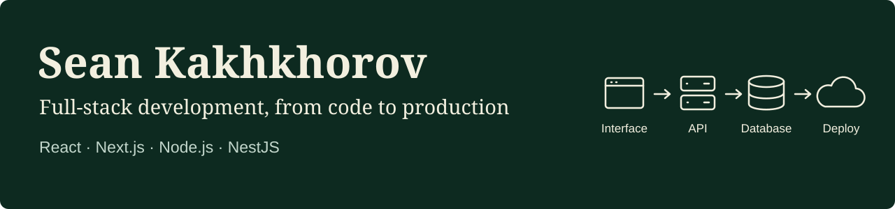

# I build and run web applications.

**Full-stack Developer · AI Engineering · Agentic Engineering · DevOps**

KakaoTalk ID: `kakhkhorov_A`

3+ years of professional experience. Frontends, APIs, authentication, real-time features, and Linux deployments.

## Featured work

### [CreatorHub](https://creatorhub.site)

A multilingual platform connecting independent creators and clients in Korea. I designed, built, and deployed the frontend, backend, and infrastructure.

- Next.js + NestJS GraphQL + MongoDB.
- Private inquiries, live chat, moderation, and social sign-in.
- Gemini assistant, automated checks, and health-checked deployments.

[Live site](https://creatorhub.site) · [Backend](https://github.com/kakhkhorov97/CreatorHub) · [Frontend](https://github.com/kakhkhorov97/CreatorHub-next)

## Core stack

| Area | Technologies |
| --- | --- |
| Frontend | TypeScript, React, Next.js, Apollo Client |
| Backend | Node.js, NestJS, Express, GraphQL, Socket.io |
| Data | MongoDB, PostgreSQL, MySQL, Redis |
| DevOps | Docker, Nginx, GitHub Actions, Ubuntu |
| AI & coding agents | Gemini API, Claude Code, Codex, Cursor |

## What I can help build

Full-stack products, backend APIs, admin dashboards, real-time workflows, and AI-powered web features.

Previously: IT Local · Atlantis Investment

Based in Suwon, South Korea. English · Korean · Uzbek.

[Email](mailto:kakhkhorov97@gmail.com) · [Telegram](https://t.me/kakhkhoro_v) · KakaoTalk ID: `kakhkhorov_A`
